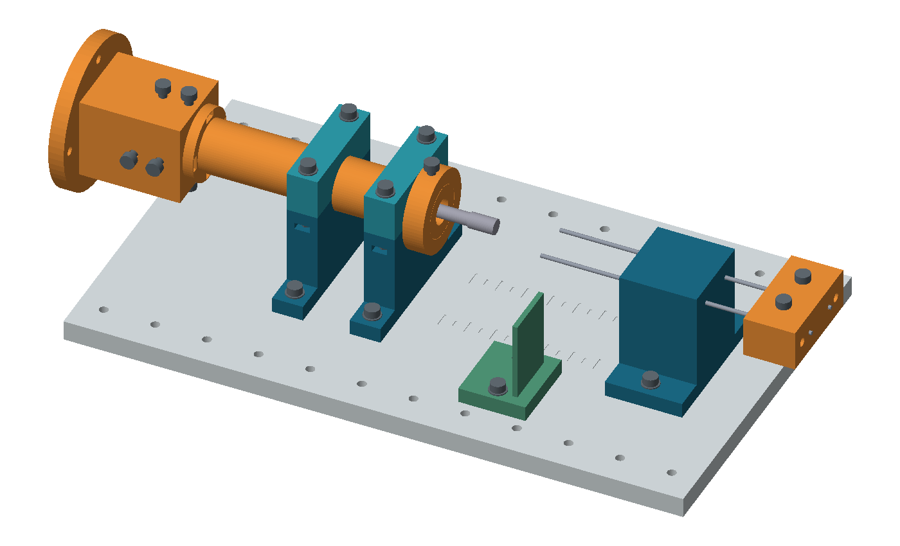

# Roche V1 Physical

**Mechanical registration for single crochet.**

A crochet hook acts on an opening made of the same strand it is pulling. Roche V1 is a bench fixture for studying that interaction. Two pins register the foundation chain relative to a sliding, rotating hook. The operator controls motion and tension.

*The orange carrier guides the hook toward the opening held by the two steel pins. The gray cylinder represents the purchased hook’s clearance envelope.*

The design has **14 printable designs** across the fixture, handheld tools, and fit coupons. A rigid-body CAD check sampled **180 combinations** of hook position, hook rotation, and pin withdrawal. It flagged no interference at those poses. The bench test examines whether the new stitch stays anchored in the intended chain after the pins withdraw.

- [Illustrated components and exploded view](docs/components.md)
- [Parts and hardware register (CSV)](docs/parts.csv)
- [Selected part models (STEP and STL)](cad/README.md)
- [Engineering notes and geometry checks](docs/engineering.md)

Designed by [Arushi Singh](https://github.com/arushis1212).
