# Fixture components

The hook and the foundation chain each have their own support. In this exploded view, the guide caps and carrier are lifted to expose the sliding journal. The orange fork on the right moves the two registration pins together.

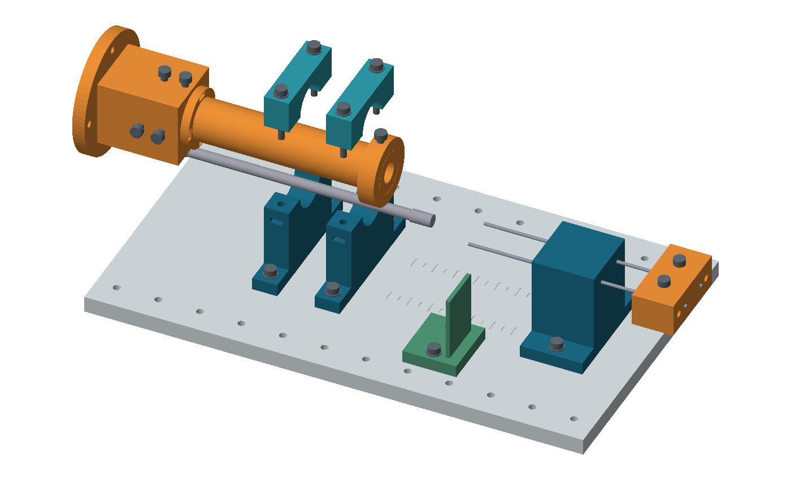

Fourteen PLA designs account for sixteen printed pieces in the kit, including the fit tools. The bench protocol specifies cotton yarn. The two hook-guide stations each use a lower guide and a cap. [Parts register (CSV)](parts.csv) · [Selected STEP and STL models](../cad/README.md)

## Frame and hook motion

| View | Part | Qty | Function |
| --- | --- | ---: | --- |
| <a href="images/parts/P01.png">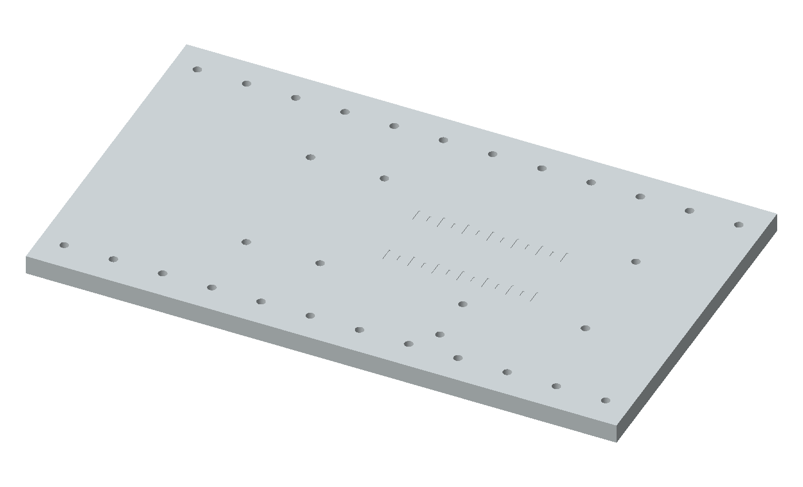</a> | **P01** Base | 1 | Locates the hook guides, pin stand and tail support on a common base. |
| <a href="images/parts/P02.png">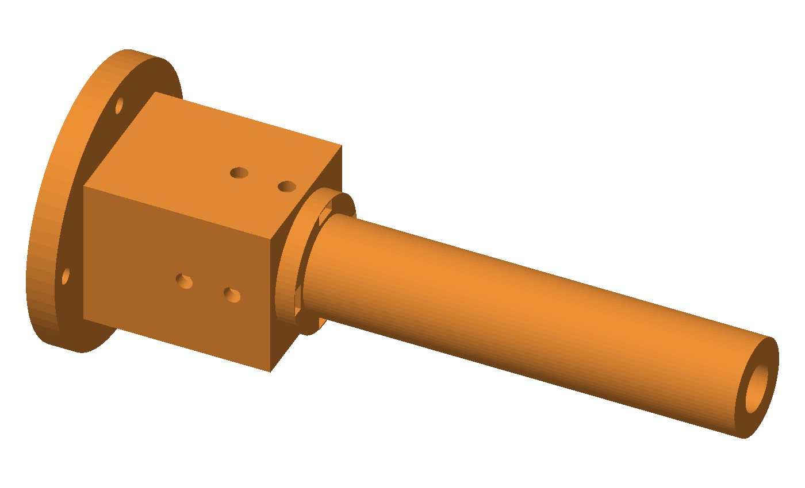</a> | **P02** Hook carrier | 1 | Holds the purchased hook as the operator slides and rolls it. |
| <a href="images/parts/P03A.png">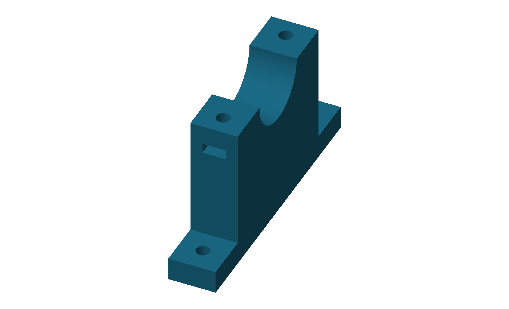</a> | **P03A** Lower guide | 2 | Supports the carrier journal at each of the two guide stations. |
| <a href="images/parts/P03B.png">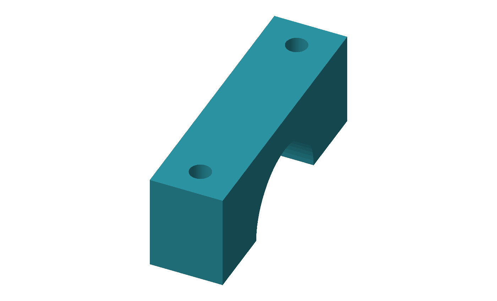</a> | **P03B** Guide cap | 2 | Closes each split guide around the journal while allowing translation and rotation. |
| <a href="images/parts/P08.png">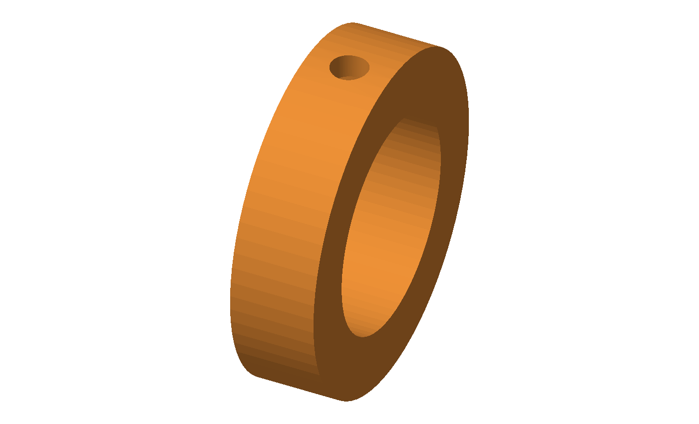</a> | **P08** Stop collar | 1 | Sets the carrier’s home end of travel. |

## Chain registration and yarn handling

| View | Part | Qty | Function |
| --- | --- | ---: | --- |
| <a href="images/parts/P04.png">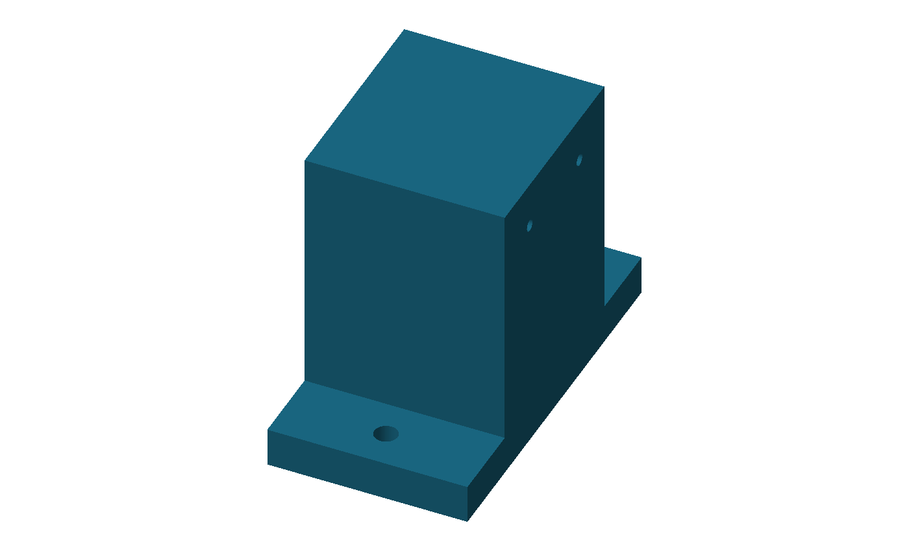</a> | **P04** Pin stand | 1 | Guides the two steel pins as they enter and withdraw from the foundation chain. |
| <a href="images/parts/P05.png">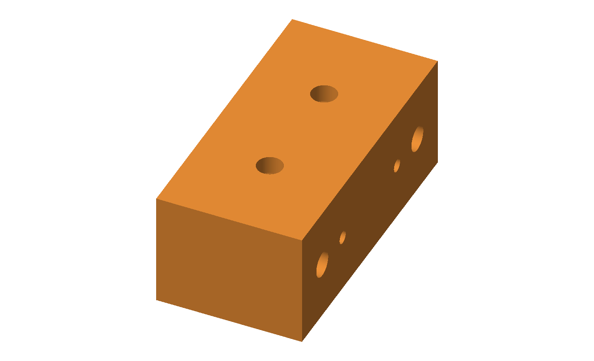</a> | **P05** Fork handle | 1 | Couples both pins so the operator can retract them together. |
| <a href="images/parts/P06.png">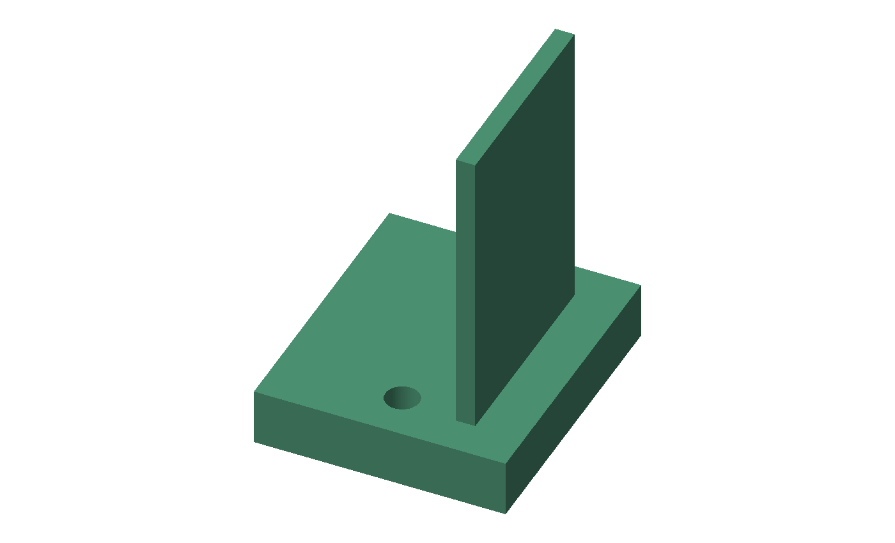</a> | **P06** Tail clamp stand · [STL](../cad/P06_chain_clamp_stand.stl) · [STEP](../cad/P06_chain_clamp_stand.step) | 1 | Carries the clip that holds the foundation tail. |
| <a href="images/parts/P07.png">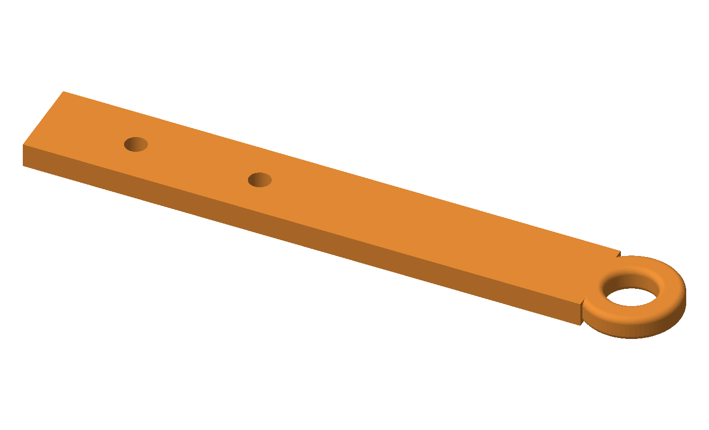</a> | **P07** Handheld yarn guide | 1 | Presents the working strand to the hook through a smooth eye. |
| <a href="images/parts/P09.png">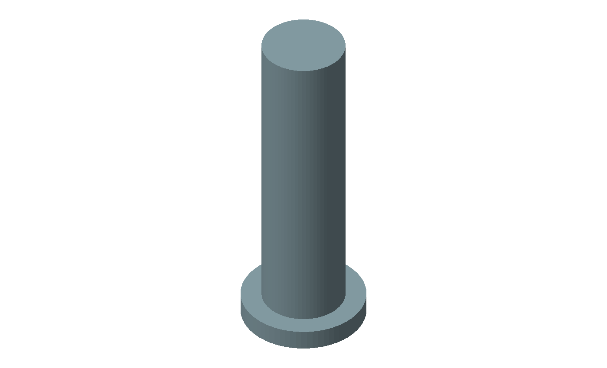</a> | **P09** Chain gauge | 1 | Checks the prepared chain opening before it goes on the pins. |

## Fit tools

| View | Part | Qty | Function |
| --- | --- | ---: | --- |
| <a href="images/parts/P00A.png">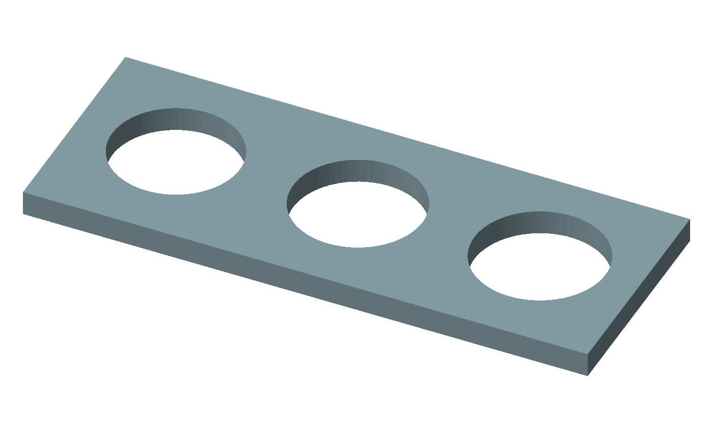</a> | **P00A** Slide-fit coupon | 1 | Provides candidate bores for checking printed sliding fits. |
| <a href="images/parts/P00B.png">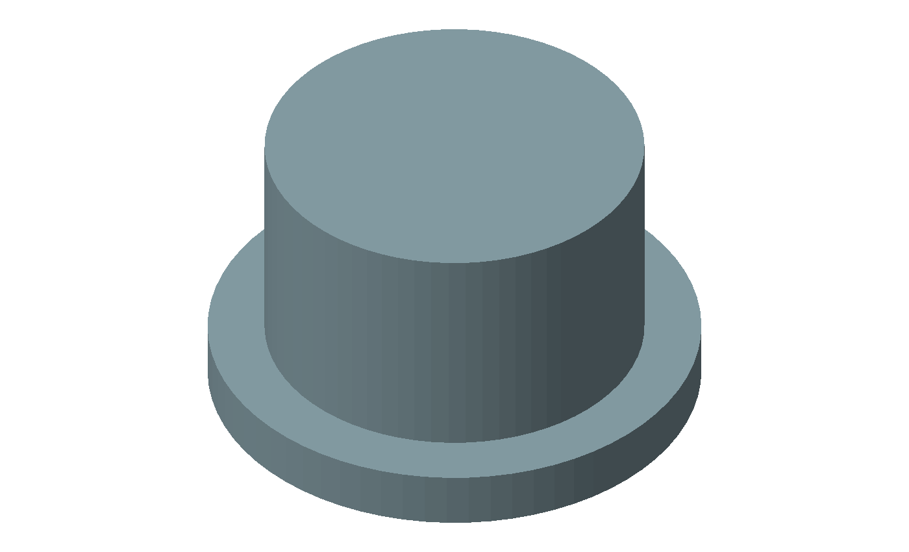</a> | **P00B** Test journal · [STL](../cad/P00B_test_journal.stl) · [STEP](../cad/P00B_test_journal.step) | 1 | Mates with the slide-fit coupon to check rotation and sliding. |
| <a href="images/parts/P00C.png">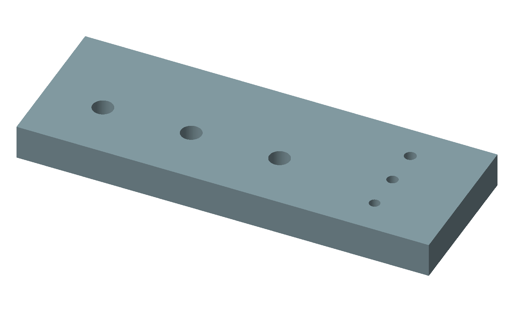</a> | **P00C** Hardware-fit coupon · [STL](../cad/P00C_hardware_coupon.stl) · [STEP](../cad/P00C_hardware_coupon.step) | 1 | Checks how purchased rod and nuts fit the printed features. |
| <a href="images/parts/P00D.png">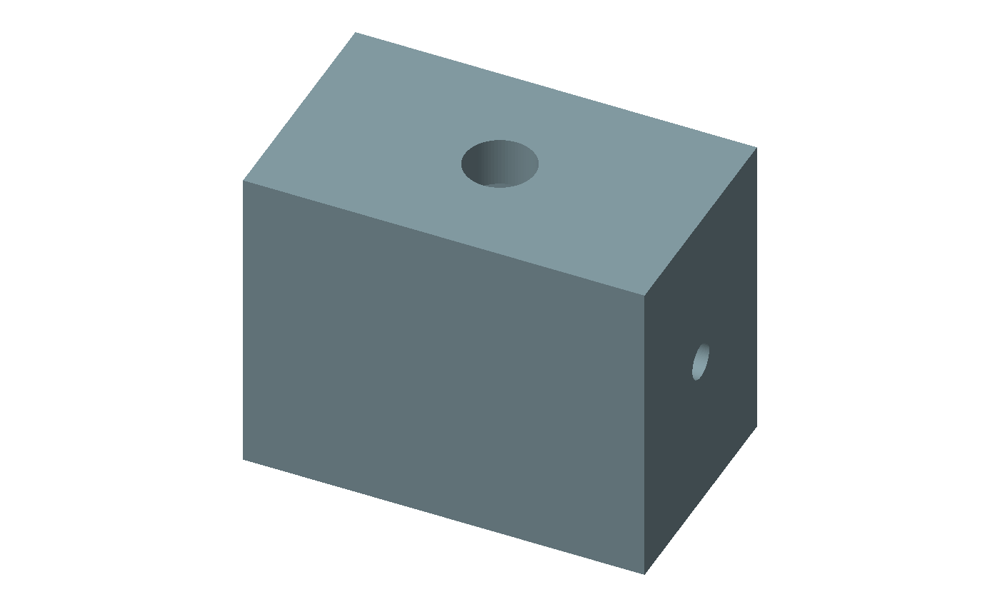</a> | **P00D** Nut-retention coupon | 1 | Reproduces a clamp feature for checking nut capture and rod retention. |

## Purchased hardware

| Component | Qty | Function |
| --- | ---: | --- |
| Crochet hook | 1 | Forms the loop. |
| Registration pins | 2 | Hold the target opening on either side of the hook path. |
| Base mounting screws | 8 | Secure the stands and guides to the base. |
| Guide cap screws | 4 | Fasten the upper and lower guide halves. |
| Hook centering screws | 8 | Center the purchased hook in its carrier. |
| Clamp screws | 3 | Secure the rods and the carrier stop. |
| Hex nuts | 23 | Receive the mounting and clamp screws. |
| Flat washers | 12 | Spread the screw-head load on the mounts and guides. |
| Tail clip | 1 | Anchors the foundation tail at its stand. |
| Feed clip | 1 | Temporarily holds the working strand. |
